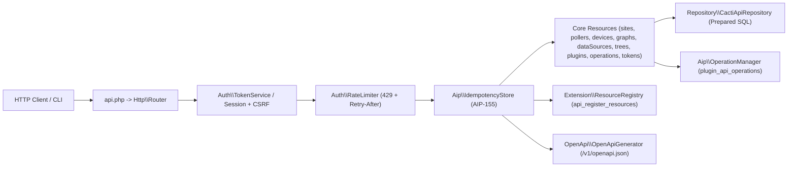

# plugin_api

`plugin_api` is a Google API Design Guide (AIP) compliant REST API plugin for Cacti 1.2 that exposes Cacti resources under `/plugins/api/api.php/v1/` (or `/api/v1/` with web server rewrites) while maintaining zero runtime Composer dependencies and strict standalone plugin independence.

## Why this plugin exists

Cacti 1.2 ships a web console and CLI scripts, but automation tools such as Terraform providers, CI pipelines, and inventory sync jobs need a typed HTTP interface with predictable pagination, filtering, concurrency control, and scoped credentials. `plugin_api` adds a resource-oriented HTTP/JSON API that honors Cacti's existing RBAC realms and per-object device, graph, and tree policies without modifying core Cacti files.

## Key capabilities

- **Google AIP v1 contract:** Implements AIP-121 and AIP-122 resource names, AIP-131 through AIP-136 standard and custom methods (`:enable`, `:disable`, `:reindex`, `:poll`, `:render`, `:cancel`, `:revoke`), AIP-151 Long-Running Operations, AIP-154 strong ETags with `If-Match`, AIP-155 `request_id` / `Idempotency-Key` replay protection, AIP-158 HMAC-signed cursor pagination (`page_size` 1 to 1000, default 50), AIP-160 recursive-descent filtering compiled to allowlisted prepared SQL parameters, AIP-161 `update_mask` and `read_mask` field masks, and AIP-193 `google.rpc.Status` error envelopes.
- **Application Passwords authentication:** Issues per-user revocable bearer tokens (`cacti_pat_<8-hex-prefix>_<48-hex-secret>`) inspired by WordPress Application Passwords. Tokens are stored as SHA-256 digests, verified with `hash_equals()`, bound to the owner's Cacti RBAC realms, and restricted by optional scopes (`read`, `write`, `admin`), expiration timestamps, and IPv4/IPv6 CIDR allowlists.
- **Composable authorization:** Uses a Drupal-inspired tri-state `AccessResult` (`allowed`, `forbidden`, `neutral`) where explicit denial always dominates, combining token scopes, Cacti realm permissions, and Cacti per-object ACLs (`policy_hosts`, `policy_graphs`, `policy_trees`, and `user_auth_perms`).
- **Live OpenAPI 3.1 discovery:** Serves `/v1/openapi.json` dynamically describing all core endpoints and any sibling plugin collections registered through `api_register_resources`.
- **Decoupled plugin ecosystem hooks:** Zero hard PHP imports of sibling plugins. Sibling plugins optionally register collections via plain PHP array descriptors (`api_register_resources`), while `plugin_api` registers `casc_register_providers` (`slug: api`, declarative config only), `doctor_register_checks`, `doctor_register_debug_info` (redacted diagnostic snapshot with zero tokens or hashes), and `abilities_register` (`api-get-status`, `api-list-operations`, `api-get-openapi`), alongside static `schema/api.schema.yaml` separating Config from State.
- **Self-graphing Cacti telemetry:** Ships a PHP 8.0-parseable Cacti script-server entry point (`scripts/ss_api_stats.php`) backed by `lib/Metrics/ApiMetricsCollector.php` emitting `active_tokens`, `revoked_tokens`, `operations_pending`, `operations_running`, `operations_failed`, `idempotency_keys`, `rate_limit_buckets`, and `registered_collections` in Cacti `field:value` format (or `field:U` on database/runtime failure).
- **Console UI and CLI:** Provides 3-tier RBAC Console pages (`api_view.php`, `api_tokens.php`, `api_admin.php`) and `cli/api.php` for token lifecycle management, OpenAPI export, operations listing, and health checks.

## Architecture



### Core collections

| Resource Name | Collection Path | Standard Methods | Custom Methods (AIP-136) |
| --- | --- | --- | --- |
| `sites/{site}` | `/v1/sites` | `List`, `Get`, `Create`, `Update`, `Delete` | |
| `pollers/{poller}` | `/v1/pollers` | `List`, `Get` | |
| `devices/{device}` | `/v1/devices` | `List`, `Get`, `Create`, `Update`, `Delete` | `:enable`, `:disable`, `:reindex`, `:poll` |
| `devices/{device}/graphs/{graph}` | `/v1/devices/{device}/graphs` | `List`, `Get` | `:render` |
| `graphs/{graph}` | `/v1/graphs` | `List`, `Get` | `:render` |
| `dataSources/{data_source}` | `/v1/dataSources` | `List`, `Get` | |
| `trees/{tree}` | `/v1/trees` | `List`, `Get` | |
| `plugins/{plugin}` | `/v1/plugins` | `List`, `Get` | |
| `operations/{operation}` | `/v1/operations` | `List`, `Get`, `Delete` | `:cancel` |
| `tokens/{token}` | `/v1/tokens` | `List`, `Get`, `Create`, `Delete` | `:revoke` |

### Config vs State boundary

Static configuration schema lives in `schema/api.schema.yaml`. Declarative configuration stored in Cacti's `settings` table (`api_enabled`, `api_rate_limit_per_min`, `api_default_token_ttl_days`, `api_cors_origins`, `api_cors_allow_credentials`, `api_require_tls`, `api_max_body_bytes`, `api_enable_yaml_negotiation`, `api_uninstall_keep_tables`) is exportable via CasC. Runtime state tables (`plugin_api_tokens`, `plugin_api_operations`, `plugin_api_idempotency`, `plugin_api_rate_limits`) are never exported.

## Installation and Quick Start

1. Place this directory at `<cacti>/plugins/api`.
2. Install and enable the plugin via Cacti CLI or Console:

```bash
php cli/plugin_manage.php --plugin=api --install --enable
```

3. Issue a scoped Application Password via CLI (secret is displayed once):

```bash
php plugins/api/cli/api.php token-create --user-id=1 --name="automation" --scopes=read,write --ttl-days=90
```

4. Query the API:

```bash
curl -sS \
  -H "Authorization: Bearer cacti_pat_<prefix>_<secret>" \
  "https://cacti.example.com/plugins/api/api.php/v1/devices?filter=status%20%3D%203&page_size=25"
```

5. Perform an idempotent create and optimistic-concurrency partial update:

```bash
curl -sS -X POST \
  -H "Authorization: Bearer cacti_pat_<prefix>_<secret>" \
  -H "Content-Type: application/json" \
  -H "Idempotency-Key: 550e8400-e29b-41d4-a716-446655440000" \
  -d '{"display_name":"West DC","city":"Seattle","country":"US"}' \
  "https://cacti.example.com/plugins/api/api.php/v1/sites"

curl -sS -X PATCH \
  -H "Authorization: Bearer cacti_pat_<prefix>_<secret>" \
  -H "Content-Type: application/json" \
  -H 'If-Match: "<etag-from-get>"' \
  -d '{"city":"Bellevue"}' \
  "https://cacti.example.com/plugins/api/api.php/v1/sites/2?update_mask=city"
```

## Registering sibling plugin resources

Sibling plugins expose collections through the `api_register_resources` Cacti hook using plain PHP arrays and callables with no PHP imports from `plugin_api`:

```php
function myplugin_api_register_resources(array $registrar): array {
	$registrar[] = [
		'plugin'         => 'myplugin',
		'collection'     => 'mypluginWidgets',
		'singleton'      => 'mypluginWidget',
		'realm_read'     => 'myplugin_view.php',
		'realm_write'    => 'myplugin_admin.php',
		'filter_fields'  => ['id', 'label'],
		'order_fields'   => ['id', 'label'],
		'mutable_fields' => ['label'],
		'handlers'       => [
			'list' => 'myplugin_api_list_widgets',
			'get'  => 'myplugin_api_get_widget',
		],
	];

	return $registrar;
}
```

## Security model

- **Secrets at rest:** Only SHA-256 digests of Application Passwords are stored in `plugin_api_tokens`. Plaintext secrets are emitted once at creation and never logged or exported. Poller DB credentials and SNMP credentials are excluded from API serializers.
- **Injection defense:** AIP-160 filters and AIP-132 `order_by` clauses are parsed by recursive descent and compiled exclusively against per-resource allowlisted column identifiers with bound SQL parameters.
- **Mass-assignment defense:** `PATCH` requests require an explicit `update_mask` validated against mutable allowlists; fields outside the mask are discarded and immutable fields fail with `400 INVALID_ARGUMENT`.
- **Transport and browser headers:** Every response emits `X-Content-Type-Options: nosniff`, `Cache-Control: no-store`, and `X-Frame-Options: DENY`. Request bodies are bounded (`api_max_body_bytes`, default 1 MiB) and require `application/json`. CORS honors an explicit allowlist and never emits `Access-Control-Allow-Credentials: true` with `*`. Session-authenticated writes require a valid `X-CSRF-Token`.
- **Rate limiting:** Fixed-window counters throttle both authenticated principals and repeated failed token attempts by IP, returning `429 RESOURCE_EXHAUSTED`, `Retry-After`, and `X-RateLimit-*` headers.

## Requirements and compatibility

- **Cacti:** 1.2.31 or later in the 1.2.x series.
- **PHP:** 8.2, 8.3, 8.4, or 8.5 at runtime (`setup.php`, `api.php`, Console pages, `include/autoload.php`, `cli/api.php`, and `scripts/ss_api_stats.php` remain PHP 8.0 parseable so older runtimes fail cleanly without parse errors).
- **Runtime dependencies:** None (`ext-json` only).

## Development and testing

```bash
composer install
composer test
CACTI_PATH=/path/to/cacti composer phpstan
```

CI runs PHP 8.0 entry-point lint, unit/security/PHPDoc coverage suites across PHP 8.2 to 8.5 with `pcov` (`clover.xml` enforcing >= 85% line coverage), PHPStan Level 9 against Cacti 1.2.31 symbols, and live MariaDB 11.8 integration tests against Cacti `release/1.2.31` and `1.2.x`.

## References

- **Google API Improvement Proposals (AIPs):** AIP-121, AIP-122, AIP-131 to AIP-136, AIP-151, AIP-154, AIP-155, AIP-158, AIP-160, AIP-161, and AIP-193 ([https://google.aip.dev/](https://google.aip.dev/)).
- **Fielding, R. T. (2000):** *Architectural Styles and the Design of Network-based Software Architectures* (Doctoral dissertation, University of California, Irvine). Grounding for resource-oriented representations, uniform interface semantics, and conditional ETag concurrency control.
- **Helland, P. (2012):** "Idempotence Is Not a Medical Condition," *ACM Queue*, 10(4), 30-40. Grounding for AIP-155 deterministic retry replay and non-duplicate mutation guarantees.

## License

GPL-2.0-or-later. See [LICENSE](LICENSE).
